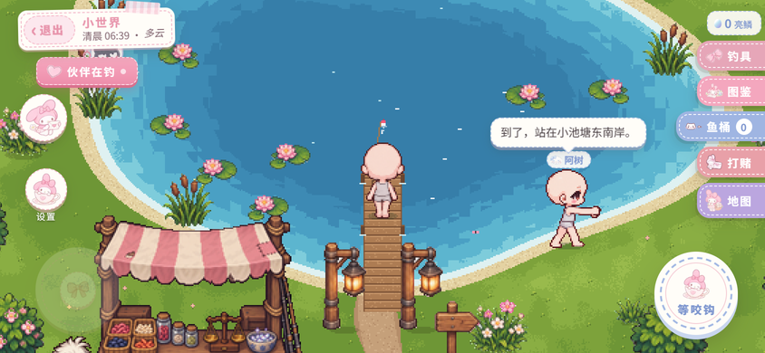
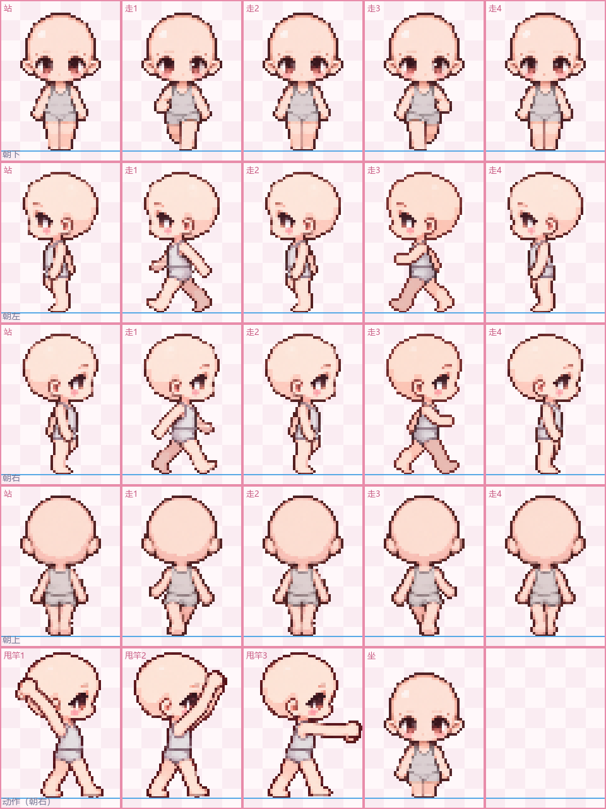

# 小世界 · 前端（web/）

一个一直在转的像素钓鱼小世界的**前端**：手机竖着拿也是横屏画面，摇杆走路、甩竿拉鱼、逛秤砣的小摊、进树洞小屋摆家具、去伞树农场种菜，和两个 AI 伙伴一起打斗地主 / 鱼桶牌、打赌记欠条。

后端（规则、存档、伙伴的自动玩法）在上一层目录，见 [../README.md](../README.md)；给 AI 看的安装教程是 [../AI-GUIDE.md](../AI-GUIDE.md)。这个目录只有画面和交互。



## 跑起来

需要 Node 18 以上。

```bash
# 在仓库根目录（上一层）
npm --prefix web install     # 第一次装依赖
node dev.js                  # 后端 + 前端一起起（只给本机）；打开终端里给的地址，进门页「世界服务地址」留空直接点「进去」
node dev.js --lan            # 手机也要玩：对同一个 WiFi 开放（公共网络别用）

# 也可以分开起：根目录 DATA_DIR=./data PORT=29901 node server/solo.js，再在 web/ 里 npm run dev
```

开发时 `/api` 会转到 `http://127.0.0.1:29901`（见 `vite.config.ts`）。后端放在别处的话，在进门页填它的地址（例：`http://192.168.1.5:29901`）；设了口令的话前端会带 `X-World-Token` 头。

打包：`npm run build`，产物在 `dist/`，放到任何静态服务器上都行。

## 换成你自己的小人

游戏里每个人（你和两个伙伴）都用一张**标准小人图**。不传就用自带的通用小人（`public/sprites/starter.png`）。

- 透明 PNG，**240 × 320**，不超过 512KB
- 一格 **48 × 64**，5 行 × 5 格；**脚底踩在每格从上往下第 60 行**（下面留 4 行空白）
- 第 1～4 行：朝下 / 朝左 / 朝右 / 朝上，每行 `[站, 走1, 走2, 走3, 走4]`
- 第 5 行：`[甩竿1, 甩竿2, 甩竿3, 坐, 空]`，朝右画；鱼竿不用画，游戏自己画



（蓝线 = 脚底线。走路四帧里，走1 和 走3 应该是左右腿互换的。）

画好以后用后端的接口传上去：

```bash
curl -X POST --data-binary @my-sprite.png -H "Content-Type: image/png" http://127.0.0.1:29901/api/world/sprite
# 给伙伴换：?who=buddy（伙伴的 id 看 GET /api/world 里的 roles）
# 换回默认：curl -X DELETE http://127.0.0.1:29901/api/world/sprite
```

用 Piskel（免费、网页版就能用）从通用小人改一张：见 [docs/piskel-tutorial.md](docs/piskel-tutorial.md)。

## 结构

```
src/pages/WorldPage.tsx   主页面：画面上面那层界面（按钮、面板、聊天气泡）和跟后端的轮询
src/pixel/world.ts        像素画面：地图、人、钓鱼、天气、小屋、农场，全在一张 canvas 上
src/pixel/doll.ts         标准小人图 → 画面用的格式
src/pixel/treehouse.ts    树洞小屋的家具和摆位
src/pages/*.tsx           各个面板：小摊、钓具箱、图鉴、斗地主、鱼桶牌、打赌、种子袋……
src/api/ccBridge.ts       后端接口（/api/world/...）
public/                   图片素材
```

人物 id 在前端里固定叫 `player`（你）/ `buddy` / `pal`（两个伙伴）。后端内容包里用别的 id 也没关系：`GET /api/world` 会带 `roles`，接口层两头自动翻译。目前前端只支持**两个伙伴**。

## 先说清楚

- **联机没实测。** 前端是照着单人版做的；后端的联机版接口形状一样，但这个前端没在联机环境里跑过。
- 画面和交互是给手机做的（iPhone Safari 测得最多），电脑浏览器能玩但没细调。

## 素材说明

- `public/fanart/` 里的贴纸，以及画面中出现的美乐蒂、玉桂狗、酷企鹅等形象，是**三丽鸥（Sanrio）角色的同人素材**（AI 生成），版权归原权利人，仅作个人非商业用途；如果你要商用或二次分发，请自己替换掉。
- 发牌的小螃蟹形象来自 Claude 的像素吉祥物，同样是同人素材。
- 其余像素画面素材随代码一起按下面的许可发布。
- 字体：霞鹜文楷（`public/fonts/wenkai/`，SIL OFL 1.1，许可见同目录 `OFL.txt`）。

## 许可

代码：AGPL-3.0（见 `LICENSE`）。三丽鸥等同人素材不在此许可范围内，见上一节。
